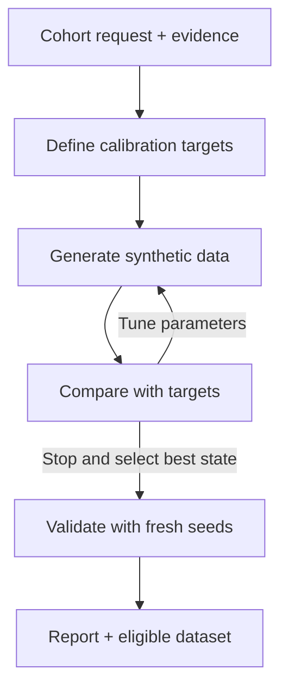

# VCT-IPD

**Evidence-calibrated synthetic individual patient data for virtual clinical trial research.**

VCT-IPD is the first project in **VCTKit**, an ecosystem for virtual clinical trial
research. It turns a cohort description and documented evidence into a reproducible
patient-data generator, with explicit assumptions and traceable results.

**v0.1 is a local research prototype for one fictional oncology cohort.** Matching
its demonstration evidence does not establish clinical validity or reconstruct real patients.

## How it works

Study summaries do not uniquely determine patient-level relationships. VCT-IPD makes
modeling assumptions explicit, then tunes **generator parameters—not individual rows**
to match adopted evidence targets.



- **Evidence stays traceable.** Raw source values and provenance are preserved;
  adoption and unit conversions are explicit. Incompatible evidence is not relabeled.
- **Evaluation determines success.** Metrics are calculated from generated data.
  Optional LLMs help plan requests, extract evidence and propose bounded actions;
  they cannot declare statistical success.
- **Validation stays independent.** Tuning uses fixed comparison seeds. Fresh seeds
  are used only after selecting a state, with no feedback into tuning. This checks
  simulation stability, not clinical validity.

## Quick start

Requires **Python 3.11+**; verified with Python 3.12. From the repository root:

```sh
python -m venv .venv
source .venv/bin/activate
python -m pip install -e '.[ui]'
python -m vct_ipd.ui --fixtures "$PWD/examples" --output "$PWD/runs/local-ui"
```

Open **http://127.0.0.1:8501**, keep the offline provider, select the English or Chinese
example, and click **Execute**. Leave live diagnostic proposals disabled. These examples
need no API key or network calls; they use recorded mock responses, not free-form
language understanding. The UI is intended for local, single-user use.

On Windows PowerShell, activate with `.venv\Scripts\Activate.ps1` and pass explicit
fixture/output paths.

| UI option | Meaning |
| --- | --- |
| `generate` | Generate, calibrate and validate a synthetic cohort |
| `collect` | Gather/extract evidence for review; no cohort is generated |
| `hypothetical-nsclc` | Use the explicitly fictional demonstration profile |
| Live diagnostic proposals | Allow a configured model to suggest controller actions; optional and potentially billable |

For CLI-only use, Pydantic is the sole mandatory runtime dependency:

```sh
python -m pip install -e .
python -m vct_ipd.application --fixtures examples --output runs/demo --token english
```

Results appear under `runs/demo/english/`. Choose a new `--token` for each CLI run.
Keep the `examples/` directory: its inputs are included in the source distribution,
but not in the wheel.

## Current scope

| Area | v0.1 implementation |
| --- | --- |
| Cohort | Fictional advanced non-small cell lung cancer (NSCLC), one DEMO-A treatment setting |
| Columns | `age`, `sex`, binary `ecog`, `os_time`, `os_event` |
| Model | Conditional ECOG relationship; Weibull proportional hazards; separate censoring with fixed individual follow-up |
| Metrics | Row validity, marginal/conditional summaries, Kaplan–Meier survival probabilities and median when estimable |
| Evidence | Local summaries, reference CSVs and recorded extraction; public literature collection remains review-only |
| Calibration | Bounded parameter updates, best-state selection, stopping budgets and independent validation |

Other cancers, multiple treatment arms, PFS, competing risks, longitudinal outcomes
and causal extrapolation are outside the executable scope. Unsupported requests remain
visible rather than being silently replaced by the demo.

## Outputs

Each run saves a readable report and an audit trail: evidence, targets, parameters,
seeds, state/action history, evaluation and stopping decisions. Eligible runs also
export `synthetic_ipd.csv`; the UI offers report and data downloads.

Structurally valid data that misses statistical targets may be exported as
**uncalibrated** with `success=False`. Structurally invalid cohorts and blocked or
failed generation runs have no canonical CSV. Diagnostic artifacts remain available.
Exact replay is supported within the tested environment, not promised across Python
versions or platforms.

## Optional live use

Install `python -m pip install -e '.[ui,openai]'`, set `OPENAI_API_KEY` and
`VCT_IPD_MODEL` in your shell, and add `--allow-live` to the UI launch command.
Select the live provider as needed; extraction and diagnostic proposals have separate
opt-ins. Calls may incur charges. Never commit credentials.

**Live model and retrieval verification has not been performed.** Offline/mock/replay
checks do not establish live-provider reliability or clinical validity.

## License

[Apache License 2.0](LICENSE). Third-party publications and data retain their own
licenses and access conditions.
